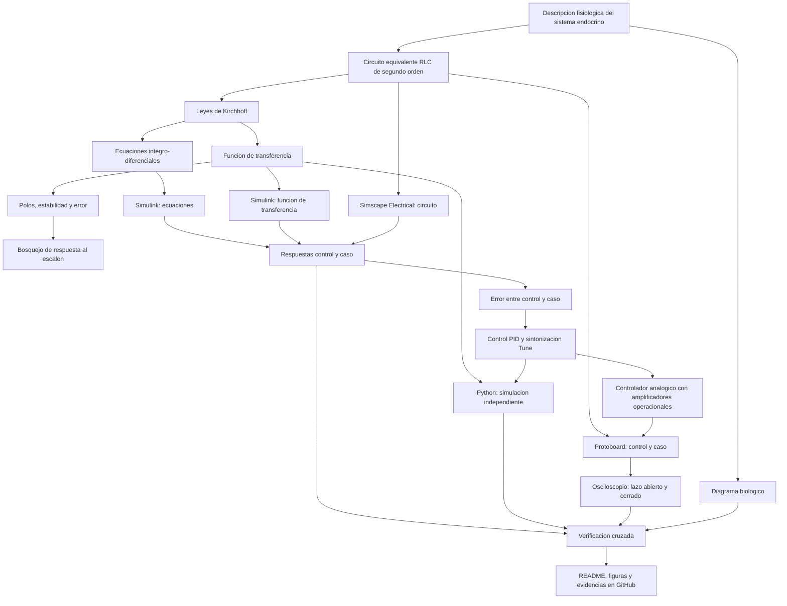

[](https://matlab.mathworks.com/open/github/v1?repo=23212806-debug/MSFP4)

# Práctica 4 — Modelado y control del sistema endócrino

Repositorio académico de la asignatura **Modelado de Sistemas Fisiológicos**, correspondiente al programa de **Ingeniería Biomédica** del Tecnológico Nacional de México / Instituto Tecnológico de Tijuana. Esta práctica integra interpretación fisiológica, analogías eléctricas, modelado matemático de segundo orden, análisis temporal y de estabilidad, diseño de controladores PID, verificación mediante simulación computacional y contraste con experimentación en el Laboratorio de Electrónica.

El caso de estudio representa de forma **fenomenológica y simplificada** los procesos de secreción, transporte, almacenamiento y respuesta hormonal mediante un circuito RLC equivalente. Se compara una condición de referencia (**control**) con una condición alterada (**caso**), obtenida al modificar simultáneamente la capacitancia $C$ y la resistencia $R_2$, y se propone una estrategia de control *in silico* para reducir la diferencia entre ambas respuestas.

**Docente:** Dr. Paul Antonio Valle Trujillo  
**Correo:** paul.valle@tectijuana.edu.mx  
**Departamento:** Ingeniería Eléctrica y Electrónica  
**Institución:** Tecnológico Nacional de México / Instituto Tecnológico de Tijuana  
**Asignatura:** Modelado de Sistemas Fisiológicos  
**Programa:** Ingeniería Biomédica  
**Estudiante:** Martínez Lozano Pedro Damián · 23212806 · 23212806@tectijuana.edu.mx

**Repositorio de la asignatura:** https://github.com/DrPaulValle/MSF-IBF1020  
**Sede:** Blvd. Alberto Limón Padilla s/n, Tijuana, C. P. 22454, B. C., México.

---

<a id="contenido"></a>
## Contenido

1. [Resumen](#resumen)
2. [Competencia y objetivos](#objetivos)
3. [Relación con el temario](#temario)
4. [Interpretación fisiológica y analogía eléctrica](#analogia)
5. [Formulación matemática](#modelo)
6. [Análisis temporal y de estabilidad](#analisis)
7. [Señales de entrada y condiciones de simulación](#senales)
8. [Implementación en MATLAB, Simulink y Simscape](#matlab)
9. [Control en lazo cerrado y sintonización PID](#pid)
10. [Reproducción en Python](#python)
11. [Diagrama biológico e interpretación fisiológica](#biologico)
12. [Implementación experimental en el laboratorio](#laboratorio)
13. [Resultados y verificación cruzada](#resultados)
14. [Flujo de trabajo](#flujo)
15. [Actividades del estudiante](#actividades)
16. [Estructura del repositorio](#estructura)
17. [Requisitos](#requisitos)
18. [Reproducibilidad y entregables](#reproducibilidad)
19. [Referencias](#referencias)

---

<a id="resumen"></a>
## Resumen

La práctica tiene como propósito **reproducir un procedimiento de modelado, análisis, simulación, control y verificación experimental** aplicado a una descripción simplificada del sistema endócrino. Un estímulo fisiológico $V_e(t)$ inicia la secreción hormonal; la hormona se transporta con pérdidas (resistencia $R_1$), se acumula temporalmente en un compartimento (capacitancia $C$) y produce una respuesta en el tejido diana, representada por una rama serie formada por una inductancia $L$ y una resistencia $R_2$. La salida $V_s(t)$ representa el nivel hormonal efectivo y normalizado disponible para producir una respuesta.

Debido a la presencia de **dos elementos independientes de almacenamiento de energía** ($C$ y $L$), el circuito constituye un **sistema dinámico de segundo orden**. Se analizan dos condiciones: control y caso. La entrada es un **escalón unitario** $V_e(t)=u(t)$ en $t\in[0,10]$ s. Posteriormente se incorpora un **controlador PID** que toma la respuesta del control como referencia, y sus ganancias $k_P$, $k_I$ y $k_D$ se utilizan para calcular un controlador analógico con amplificadores operacionales.

El modelo **no representa un eje hormonal específico** ni establece una equivalencia directa entre los valores de los componentes eléctricos y parámetros fisiológicos medidos. Su finalidad es reproducir cualitativamente propiedades dinámicas como almacenamiento, disipación, retardo e inercia de la respuesta. El controlador constituye una estrategia académica y **no una intervención terapéutica**.

**Palabras clave:** sistema endócrino; secreción hormonal; analogía eléctrica; circuito RLC; sistema de segundo orden; función de transferencia; controlador PID; MATLAB; Simulink; Simscape Electrical; Python; controlador analógico.

[Volver al contenido](#contenido)

---

<a id="objetivos"></a>
## Competencia y objetivos

### Competencia a desarrollar

Modelizar sistemas fisiológicos mediante analogías eléctricas, ecuaciones diferenciales y funciones de transferencia para analizar su comportamiento dinámico y diseñar estrategias de control mediante técnicas de control clásico. En particular, interpretar una descripción simplificada de los procesos de secreción, transporte, almacenamiento y respuesta hormonal para proponer un circuito eléctrico equivalente de segundo orden; comparar una condición de referencia (control) con una condición alterada (caso); diseñar un controlador PID y contrastar los resultados mediante modelado analítico, simulación computacional y experimentación en el Laboratorio de Electrónica.

### Objetivo general

Modelar, simular y controlar un sistema endócrino simplificado mediante su circuito eléctrico equivalente de segundo orden, identificar las diferencias dinámicas entre las condiciones de control y caso, y evaluar una estrategia de control PID utilizando MATLAB/Simulink, Simscape Electrical, Python y su implementación experimental.

### Objetivos específicos

- Construir el circuito equivalente identificando $V_e(t)$, $V_s(t)$, $R_1$, $C$, $L$, $R_2$, $F_e(t)$, $F_s(t)$, los nodos principales y la referencia.
- Obtener $G(s)=V_s(s)/V_e(s)$ para control y caso, y relacionar su orden con los elementos $C$ y $L$.
- Calcular el error en estado estacionario, los polos y la estabilidad de ambas condiciones.
- Bosquejar cualitativamente las respuestas al escalón y compararlas con las simulaciones.
- Formular el modelo mediante ecuaciones integro-diferenciales aplicando las leyes de Kirchhoff.
- Implementar el sistema por ecuaciones, función de transferencia y Simscape Electrical, y comparar sus respuestas en $t\in[0,10]$ s.
- Incorporar un controlador PID, registrar $k_P$, $k_I$ y $k_D$ obtenidas con **Tune** y diseñar su versión analógica con amplificadores operacionales.
- Reproducir las respuestas en Python y contrastarlas con las de MATLAB/Simulink.
- Construir en protoboard los circuitos de control y caso, y comparar las respuestas experimentales con las simuladas.
- Relacionar los elementos del modelo con estructuras fisiológicas y documentar los resultados en GitHub.

[Volver al contenido](#contenido)

---

<a id="temario"></a>
## Relación con el temario

La práctica retoma conceptos de tres áreas de la asignatura **Modelado de Sistemas Fisiológicos (IBF-1020)**:

| Unidad | Área | Contenidos aplicados |
|---|---|---|
| I | Sistemas de control retroalimentados | Comparación de respuestas control/caso, definición del error $e(t)$ y retroalimentación |
| II | Modelado matemático | Analogía eléctrica, leyes de Kirchhoff, ecuaciones integro-diferenciales y función de transferencia de segundo orden |
| III | Controladores | Control PID, sintonización con Tune, implementación analógica y análisis de respuesta en lazo cerrado |

El enfoque integra **Ingeniería de Control, Electrónica, Ciencias de la Computación y Fisiología Endócrina**, vinculando procesos de secreción, transporte, almacenamiento y respuesta hormonal con un modelo dinámico simplificado.

[Volver al contenido](#contenido)

---

<a id="analogia"></a>
## Interpretación fisiológica y analogía eléctrica

### Hipótesis del modelo

1. Un estímulo fisiológico (neural, metabólico u homeostático) inicia la secreción hormonal y se representa mediante la fuente de voltaje $V_e(t)$.
2. El transporte de la hormona desde la glándula hasta el compartimento de efecto puede presentar retrasos, pérdidas o eliminación; esta oposición se representa mediante la resistencia $R_1$.
3. Parte de la señal hormonal se acumula temporalmente antes de ser utilizada o eliminada; esta capacidad de almacenamiento se representa mediante la capacitancia $C$.
4. La respuesta del tejido diana no es instantánea; la oposición a cambios rápidos y el retardo se representan mediante una rama serie formada por la inductancia $L$ y la resistencia $R_2$.
5. El flujo de secreción y transporte se representa mediante $F_e(t)$ y el flujo asociado con la utilización o respuesta del órgano diana mediante $F_s(t)$.
6. La salida $V_s(t)$ representa el nivel efectivo y normalizado de la señal hormonal disponible en el compartimento de interés.

### Topología del circuito equivalente

La rama principal está formada por la fuente $V_e(t)$ y el resistor $R_1$. En el nodo posterior a $R_1$ se conecta el capacitor $C$ hacia la referencia, en paralelo con la rama serie $L$–$R_2$. La variable $V_s(t)$ se mide en el nodo de unión entre $R_1$, $C$ y $L$.

```text
             R1            Vs(t)
   ┌───────/\/\/\────────●──────────┐
   │     ──► F_e(t)       │          │
  (+)                    ─┴─ C       L
  Ve(t)                  ─┬─         │  ──► F_s(t)
  (−)                     │          R2
   │                      │          │
   └──────────────────────┴──────────┘
               referencia (tierra)
```

La corriente de entrada se divide en el nodo de salida:

```math
F_e(t)=F_C(t)+F_s(t),\qquad F_C(t)=C\,\frac{dV_s(t)}{dt}.
```

### Correspondencias de la analogía

| Variable o proceso fisiológico | Representación eléctrica | Interpretación dentro del modelo |
|---|---|---|
| Estímulo para la secreción hormonal | $V_e(t)$ | Señal de entrada que activa la respuesta del sistema |
| Flujo de secreción y transporte hormonal | $F_e(t)$ | Corriente asociada con la transferencia de la señal desde la fuente hacia el compartimento de respuesta |
| Pérdidas y oposición durante el transporte | $R_1$ | Procesos que reducen o retardan la transmisión de la señal hormonal |
| Acumulación temporal de hormona | $C$ | Capacidad de almacenar temporalmente la señal hormonal |
| Retardo o inercia de la respuesta del tejido diana | $L$ | Resistencia dinámica a cambios rápidos en la respuesta hormonal |
| Utilización, disipación o eliminación de la señal | $R_2$ | Oposición asociada con la utilización o desaparición de la señal en el compartimento de respuesta |
| Flujo asociado con la respuesta del tejido diana | $F_s(t)$ | Corriente de la rama que representa la respuesta del órgano diana |
| Nivel hormonal efectivo | $V_s(t)$ | Variable de salida normalizada |

### Parámetros de los circuitos (valores comerciales)

| Componente | Control | Caso | Unidad |
|---|---:|---:|---|
| $R_1$ | 1 | 1 | kΩ |
| $L$ | 100 | 100 | mH |
| $C$ | 1 | 1000 | µF |
| $R_2$ | 100 | 1 | kΩ |
| $V_e(t)$ | $u(t)$ | $u(t)$ | V |

**Condiciones del modelo:** $R_1$ y $L$ permanecen constantes. La modificación simultánea de $C$ (de 1 µF a 1000 µF) y de $R_2$ (de 100 kΩ a 1 kΩ) produce una dinámica distinta entre control y caso, y permite analizar el efecto de las propiedades de almacenamiento y disipación sobre la respuesta temporal.

> **Alcance de la analogía:** las unidades y los valores de los componentes eléctricos no representan directamente magnitudes fisiológicas del sistema endócrino. Es una analogía fenomenológica con fines académicos.

[Volver al contenido](#contenido)

---

<a id="modelo"></a>
## Formulación matemática

El desarrollo completo, a mano, se conserva en [`analisis_matematico.pdf`](analisis_matematico.pdf). A continuación se presenta la versión depurada, con condiciones iniciales nulas.

### 1. Relaciones constitutivas y leyes de Kirchhoff

Ley de corrientes en el nodo de salida y ley de voltajes en la malla de entrada:

```math
F_e(t)=F_C(t)+F_s(t),\qquad F_e(t)=\frac{V_e(t)-V_s(t)}{R_1}.
```

Elementos de almacenamiento y rama de respuesta:

```math
F_C(t)=C\,\frac{dV_s(t)}{dt},\qquad V_s(t)=V_L(t)+V_{R_2}(t)=L\,\frac{dF_s(t)}{dt}+R_2F_s(t).
```

### 2. Modelo de ecuaciones integro-diferenciales

Despejando las variables de los dos elementos independientes de almacenamiento, $V_s(t)$ (capacitor) y $F_s(t)$ (inductor):

```math
C\frac{dV_s(t)}{dt}=F_e(t)-F_s(t)\;\Rightarrow\;V_s(t)=V_s(0)+\frac{1}{C}\int_0^t\big[F_e(\tau)-F_s(\tau)\big]\,d\tau,
```

```math
L\frac{dF_s(t)}{dt}=V_s(t)-R_2F_s(t)\;\Rightarrow\;F_s(t)=F_s(0)+\frac{1}{L}\int_0^t\big[V_s(\tau)-R_2F_s(\tau)\big]\,d\tau,
```

```math
F_e(t)=\frac{V_e(t)-V_s(t)}{R_1}.
```

Equivalentemente, en variables de estado, con $`\mathbf{x}=\begin{bmatrix}V_s\\F_s\end{bmatrix}`$:

```math
\dot{\mathbf{x}}=\begin{bmatrix}-\dfrac{1}{R_1C}&-\dfrac{1}{C}\\\dfrac{1}{L}&-\dfrac{R_2}{L}\end{bmatrix}\mathbf{x}+\begin{bmatrix}\dfrac{1}{R_1C}\\0\end{bmatrix}V_e(t).
```

### 3. Función de transferencia

Aplicando la transformada de Laplace con condiciones iniciales nulas:

```math
\frac{V_e(s)-V_s(s)}{R_1}=CsV_s(s)+\frac{V_s(s)}{Ls+R_2}.
```

Multiplicando por $R_1(Ls+R_2)$ y agrupando términos:

```math
V_e(s)\,(Ls+R_2)=V_s(s)\Big[R_1Cs(Ls+R_2)+R_1+(Ls+R_2)\Big],
```

```math
\boxed{G(s)=\frac{V_s(s)}{V_e(s)}=\frac{Ls+R_2}{R_1LC\,s^2+(R_1R_2C+L)\,s+(R_1+R_2)}.}
```

El denominador es un polinomio de **segundo orden** porque el circuito contiene dos elementos de almacenamiento independientes: $C$ y $L$.

### 4. Funciones de transferencia de control y caso

Sustituyendo $`R_1=1\,\mathrm{k\Omega}`$ y $`L=0.1\,\mathrm{H}`$ (con $C$ en farads y $R_2$ en ohmios):

```math
\boxed{G_{\text{control}}(s)=\frac{0.1\,s+100\,000}{0.0001\,s^2+100.1\,s+101\,000}}\qquad(C=1\,\mu\mathrm{F},\;R_2=100\,\mathrm{k\Omega})
```

```math
\boxed{G_{\text{caso}}(s)=\frac{0.1\,s+1\,000}{0.1\,s^2+1\,000.1\,s+2\,000}}\qquad(C=1000\,\mu\mathrm{F},\;R_2=1\,\mathrm{k\Omega})
```

Coeficientes del caso: $R_1LC=1000\cdot0.1\cdot10^{-3}=0.1$; $R_1R_2C+L=1000\cdot1000\cdot10^{-3}+0.1=1000.1$; $R_1+R_2=2000$.

> **Nota de verificación:** en el desarrollo manual (`analisis_matematico.pdf`, página 2) el coeficiente de $s$ del caso aparece escrito como $100.1$; el valor correcto es **$1000.1$**, que es el que se utiliza en el cálculo de polos de la página 3 y en este documento.

[Volver al contenido](#contenido)

---

<a id="analisis"></a>
## Análisis temporal y de estabilidad

### 1. Error en estado estacionario

Para la entrada escalón unitario $V_e(s)=1/s$, el error es $E(s)=V_e(s)-V_s(s)=\big[1-G(s)\big]V_e(s)$. Por el teorema del valor final:

```math
e_{ss}=\lim_{s\to0}sE(s)=1-G(0)=1-\frac{R_2}{R_1+R_2}=\frac{R_1}{R_1+R_2}.
```

| Condición | $G(0)=V_s(\infty)$ | $e_{ss}$ |
|---|---:|---:|
| Control | $`\dfrac{100\,000}{101\,000}=0.990099`$ | $`0.009901\;(0.99\,\%)`$ |
| Caso | $\dfrac{1000}{2000}=0.5$ | $`0.5\;(50\,\%)`$ |

**Distinción importante:** este $e_{ss}$ mide el seguimiento del escalón unitario por cada sistema por separado. El error que alimenta al PID es distinto: $e(t)=V_{s,\text{control}}(t)-V_{s,\text{caso}}(t)$, y su valor final sin controlador es:

```math
e(\infty)=0.990099-0.5=0.490099.
```

> **Nota de verificación:** en el desarrollo manual (página 3) esta resta aparece como $0.498099$; el resultado correcto es **$0.490099$**.

### 2. Polos y estabilidad

Los polos son las raíces de $`R_1LC\,s^2+(R_1R_2C+L)\,s+(R_1+R_2)=0`$:

```math
s_{1,2}=\frac{-(R_1R_2C+L)\pm\sqrt{(R_1R_2C+L)^2-4R_1LC(R_1+R_2)}}{2R_1LC}.
```

| Magnitud | Control | Caso |
|---|---:|---:|
| Polo $s_1$ (rad/s) | $-1010.0101$ | $-2.0002$ |
| Polo $s_2$ (rad/s) | $`-999\,989.9899`$ | $-9998.9998$ |
| Cero $z=-R_2/L$ (rad/s) | $`-1\,000\,000`$ | $`-10\,000`$ |
| Constante de tiempo dominante $\tau=1/\lvert s_1\rvert$ | 0.990 ms | 0.4999 s |
| $\omega_n=\sqrt{(R_1+R_2)/(R_1LC)}$ (rad/s) | 31 780 | 141.42 |
| $\zeta=\dfrac{R_1R_2C+L}{2\sqrt{R_1LC(R_1+R_2)}}$ | 15.75 | 35.36 |

Ambos sistemas tienen **polos reales, distintos y en el semiplano izquierdo**, por lo que son **asintóticamente estables** y **sobreamortiguados** ($\zeta>1$). En ambos casos el cero queda prácticamente superpuesto con el polo rápido (control: $-10^6$ frente a $`-999\,990`$; caso: $`-10\,000`$ frente a $-9999$), de modo que cada respuesta se comporta, en la práctica, como un sistema de **primer orden** gobernado por su polo dominante.

**Efecto de $R_2$ y $C$:** el aumento de $C$ (1 µF → 1000 µF) y la disminución de $R_2$ desplazan el polo dominante de $-1010$ a $-2.0$ rad/s. La respuesta del caso es unas 500 veces más lenta que la del control y se estabiliza en un valor menor.

### 3. Bosquejo cualitativo de las respuestas al escalón

| Condición | Valor final | Rapidez | Forma |
|---|---|---|---|
| Control | $\approx0.99$ | Muy rápida (milisegundos) | Crecimiento exponencial sin sobreimpulso |
| Caso | $0.5$ | Lenta (orden de segundos) | Crecimiento exponencial sin sobreimpulso |

Los bosquejos manuales realizados antes de simular se encuentran en la página 4 de [`analisis_matematico.pdf`](analisis_matematico.pdf).

### 4. Predicciones analíticas

Las siguientes cifras se obtuvieron de las funciones de transferencia anteriores (cálculo numérico de la respuesta al escalón) y son **predicciones**, no mediciones de simulación ni de laboratorio:

| Magnitud | Control | Caso |
|---|---:|---:|
| Valor final $V_s(\infty)$ | 0.9901 | 0.5000 |
| Tiempo de establecimiento al 2 % (aprox.) | 3.9 ms | 1.96 s |
| Tiempo de subida 10–90 % (aprox.) | 2.2 ms | 1.10 s |
| Sobreimpulso | 0 % | 0 % |

[Volver al contenido](#contenido)

---

<a id="senales"></a>
## Señales de entrada y condiciones de simulación

La práctica utiliza un **escalón unitario** que representa un estímulo sostenido aplicado al sistema:

```math
V_e(t)=u(t),\qquad 0\le t\le10\,\mathrm{s}.
```

| Elemento | Configuración o definición | Propósito |
|---|---|---|
| Entrada $V_e(t)$ | Escalón unitario | Representar un estímulo hormonal sostenido |
| Condición control | $`C=1\,\mu\mathrm{F}`$, $`R_2=100\,\mathrm{k\Omega}`$ | Respuesta de referencia |
| Condición caso | $`C=1000\,\mu\mathrm{F}`$, $`R_2=1\,\mathrm{k\Omega}`$ | Condición alterada |
| Sistema controlado | Caso con PID | Reducir la diferencia respecto al control |
| Tiempo | 0–10 s | Comparar la evolución temporal |
| Condiciones iniciales | $V_s(0)=0$, $F_s(0)=0$ | Respuesta forzada |

Debido a que el polo más rápido del control está en $-10^6$ rad/s, la configuración del paso máximo del solver debe documentarse junto con las gráficas, pues condiciona la resolución de la respuesta inicial.

[Volver al contenido](#contenido)

---

<a id="matlab"></a>
## Implementación en MATLAB, Simulink y Simscape

Se construyen, para control y caso, las tres representaciones solicitadas:

| Implementación | Descripción | Aspecto por verificar |
|---|---|---|
| Ecuaciones integro-diferenciales, Simulink | Integradores de $V_s$ y $F_s$ con las relaciones de la sección anterior | Consistencia con las ecuaciones de Kirchhoff |
| Función de transferencia, Simulink | Bloque `Transfer Fcn` con $G_{\text{control}}(s)$ y $G_{\text{caso}}(s)$ | Coeficientes de cada condición |
| Circuito equivalente, Simscape Electrical | $V_e$, $R_1$, $C$, $L$ y $R_2$ con sensor de voltaje en $V_s$ | Topología y punto de medición |

El modelo de simulación se conserva en [`sistema1.slx`](sistema1.slx) y el cuaderno computacional en [`Martinez23212806.mlx`](Martinez23212806.mlx). El cuaderno ejecuta el modelo de Simulink, extrae las respuestas de control, caso y sistema controlado, y las grafica identificando variables y unidades. Las figuras se guardan en formato PDF ([`grafica_MATLAB.pdf`](grafica_MATLAB.pdf)) y el cuaderno exportado se conserva en [`cuadernillo_MATLAB.pdf`](cuadernillo_MATLAB.pdf).

Las tres representaciones deben producir respuestas consistentes bajo las mismas condiciones iniciales y la misma entrada.

[Volver al contenido](#contenido)

---

<a id="pid"></a>
## Control en lazo cerrado y sintonización PID

### 1. Retroalimentación negativa

El esquema general de la **Figura 5.5** del instructivo utiliza la respuesta del individuo sano como referencia para el caso. La señal de error se define como:

```math
\boxed{e(t)=V_{s,\text{control}}(t)-V_{s,\text{caso}}(t).}
```

La ley de control PID ideal y su función de transferencia son:

```math
u(t)=k_Pe(t)+k_I\int_0^te(\tau)\,d\tau+k_D\frac{de(t)}{dt},\qquad K(s)=k_P+\frac{k_I}{s}+k_Ds.
```

El controlador produce la señal de tratamiento que se aplica al caso para aproximar su respuesta a la del control. La estructura exacta del lazo debe verificarse en [`sistema1.slx`](sistema1.slx).

### 2. Sintonización del controlador

Se utiliza la herramienta **Tune** del bloque `PID Controller` de Simulink buscando una respuesta estable y una reducción del error entre el caso y el control.

| Ganancia | Valor obtenido |
|---|---|
| $k_P$ | Por registrar |
| $k_I$ | Por registrar |
| $k_D$ | Por registrar |

Los criterios de evaluación del instructivo son **estabilidad** y **reducción de la diferencia** entre caso y control; no se especifican valores numéricos obligatorios de tiempo de establecimiento ni sobreimpulso.

### 3. Comparación de lazo cerrado

Se repite la simulación con el escalón unitario y se comparan $V_{s,\text{control}}(t)$, $V_{s,\text{caso}}(t)$ y $V_{s,\text{PID}}(t)$, analizando el error, la rapidez de respuesta, el comportamiento transitorio y el estado estacionario. Los parámetros y las condiciones iniciales se mantienen constantes al contrastar modelos.

### 4. Controlador analógico

Las ganancias $k_P$, $k_I$ y $k_D$ se utilizan como especificaciones para calcular las resistencias y capacitores de un PID con amplificadores operacionales, seleccionando valores comerciales. El controlador se construye primero en Simscape Electrical y su respuesta se compara con la del bloque ideal `PID Controller`.

| Elemento del controlador analógico | Valor comercial |
|---|---|
| Resistencias | Por registrar |
| Capacitores | Por registrar |
| Alimentación simétrica de los amplificadores | Por registrar |

> El diseño del PID se realiza exclusivamente con fines académicos y de simulación y no constituye una propuesta de tratamiento clínico.

[Volver al contenido](#contenido)

---

<a id="python"></a>
## Reproducción en Python

La implementación en **Python**, mediante **Visual Studio Code**, permite contrastar la simulación con una herramienta independiente. El procedimiento incluye:

1. Definición del vector de tiempo entre 0 y 10 s.
2. Definición de las funciones de transferencia $G_{\text{control}}(s)$ y $G_{\text{caso}}(s)$.
3. Cálculo de los polos de ambos modelos.
4. Obtención de la respuesta al escalón unitario de control y caso.
5. Incorporación de las ganancias $k_P$, $k_I$ y $k_D$ obtenidas con **Tune**.
6. Construcción del sistema del caso en lazo cerrado conforme al diagrama de Simulink.
7. Generación y almacenamiento de las figuras comparativas con MATLAB/Simulink.

La implementación se conserva en [`Martinez23212806.py`](Martinez23212806.py) y la figura generada en [`grafica_PYTHON.png`](grafica_PYTHON.png). Deben especificarse las bibliotecas importadas por el script y verificarse la correspondencia de sus resultados con MATLAB/Simulink.

[Volver al contenido](#contenido)

---

<a id="biologico"></a>
## Diagrama biológico e interpretación fisiológica

El diagrama relaciona los elementos del circuito con estructuras y procesos del sistema endócrino. Se elaboró con **BioRender**.


*Figura: correspondencia entre los elementos del circuito equivalente y el sistema endócrino. Elaborado en BioRender.*

| Elemento del modelo | Elemento biológico o interpretación en el diagrama |
|---|---|
| $V_e(t)$ | Secreción de hormonas en la glándula endócrina |
| $F_e(t)$ | Flujo de la señal hormonal desde la glándula hacia el compartimento de almacenamiento |
| $R_1$ | Pérdidas de transporte |
| $C$ | Almacenamiento de T3/T4 en la tiroides |
| $L$ | Resistencia dinámica a cambios rápidos en la respuesta (asociada en la figura al páncreas) |
| $R_2$ | Oposición asociada al consumo o degradación hormonal (receptores de los huesos) |
| $V_s(t)$ | Salida normalizada de la señal hacia el tejido receptor |
| Respuesta metabólica | Efecto final de la señal hormonal disponible |

### Alcance fisiológico

El diagrama es una **representación ilustrativa**: las estructuras anatómicas (tiroides, páncreas, riñón, hueso) se utilizan para dar contexto fisiológico a cada elemento del circuito y no implican que cada componente eléctrico corresponda a un órgano concreto. El riñón aparece en la figura como parte del contexto anatómico, sin un parámetro eléctrico asignado.

[Volver al contenido](#contenido)

---

<a id="laboratorio"></a>
## Implementación experimental en el laboratorio

Debido a que los valores seleccionados corresponden a componentes comerciales, los circuitos se construyen en el Laboratorio de Electrónica para contrastar las respuestas simuladas con las experimentales.

### Lazo abierto

1. Construir en protoboard los circuitos de control y caso con los valores de la tabla de parámetros.
2. Configurar el generador de funciones para producir una aproximación experimental al escalón unitario.
3. Registrar simultáneamente $V_e(t)$ y $V_s(t)$ con el osciloscopio y guardar las capturas.

### Lazo cerrado

1. Construir el controlador analógico y conectarlo al circuito del caso.
2. Configurar la alimentación simétrica de los amplificadores operacionales según las especificaciones del laboratorio.
3. Aplicar de nuevo la señal de entrada y registrar las respuestas en lazo abierto y lazo cerrado.

### Fuentes de diferencia entre simulación y experimento

- Tolerancias de resistores, capacitores e inductores.
- Resistencia interna y comportamiento no ideal del inductor.
- Tolerancia y resistencia serie equivalente del capacitor.
- Valores comerciales utilizados para implementar el controlador.
- Características no ideales de los amplificadores operacionales.
- Limitaciones de los instrumentos de medición.
- Aproximación experimental utilizada para generar el escalón.

[Volver al contenido](#contenido)

---

<a id="resultados"></a>
## Resultados y verificación cruzada

Las respuestas permiten contrastar **entrada, control, caso y sistema controlado** ante el mismo escalón.

### Señales presentadas

| Señal | Variable | Interpretación |
|---|---|---|
| Entrada | $V_e(t)$ | Escalón unitario |
| Control | $V_{s,\text{control}}(t)$ | Respuesta de referencia |
| Caso | $V_{s,\text{caso}}(t)$ | Respuesta de la condición alterada en lazo abierto |
| Sistema controlado | $V_{s,\text{PID}}(t)$ | Respuesta del caso con controlador |

### Archivos y evidencias del repositorio

| Representación | Archivo | Contenido |
|---|---|---|
| Análisis matemático | [`analisis_matematico.pdf`](analisis_matematico.pdf) | Desarrollo manual: función de transferencia, estabilidad, error, ecuaciones integro-diferenciales y bosquejos |
| Simulink y Simscape | [`sistema1.slx`](sistema1.slx) | Modelo de simulación |
| Cuaderno MATLAB | [`Martinez23212806.mlx`](Martinez23212806.mlx) | Ejecución y análisis computacional |
| Cuaderno exportado | [`cuadernillo_MATLAB.pdf`](cuadernillo_MATLAB.pdf) | Evidencia del cuaderno |
| Resultados MATLAB | [`grafica_MATLAB.pdf`](grafica_MATLAB.pdf) | Gráficas de MATLAB |
| Código Python | [`Martinez23212806.py`](Martinez23212806.py) | Implementación en Python |
| Resultados Python | [`grafica_PYTHON.png`](grafica_PYTHON.png) | Gráfica de Python |
| Resultados de laboratorio | [`grafica_LABORATORIO.jpeg`](grafica_LABORATORIO.jpeg) | Respuestas experimentales |
| Control PID | [`controlador_PID.png`](controlador_PID.png) | Evidencia del controlador |
| Diagrama biológico | [`biorender.png`](biorender.png) | Correspondencia con el sistema fisiológico |
| Citación | [`CITATION.cff`](CITATION.cff) | Información del alumno y del repositorio |
| Licencia | [`LICENSE`](LICENSE) | Licencia del repositorio |

### Aspectos para discutir

- Concordancia entre ecuaciones integro-diferenciales, función de transferencia y Simscape Electrical.
- Diferencia entre control y caso: valor final (0.99 frente a 0.5) y rapidez (polo dominante de $-1010$ frente a $-2.0$ rad/s).
- Efecto de modificar $C$ y $R_2$ sobre la posición de los polos.
- Cambios en error, rapidez y comportamiento transitorio después del PID.
- Correspondencia entre las gráficas de MATLAB y Python bajo parámetros idénticos.
- Diferencias entre simulación y laboratorio atribuibles a la no idealidad de los componentes y de los instrumentos.

**Resultados del estudiante:** las ganancias sintonizadas, los componentes del controlador analógico y las conclusiones cuantitativas se incorporan a partir de ejecuciones verificables. No se inventan resultados de simulación ni de laboratorio.

[Volver al contenido](#contenido)

---

<a id="flujo"></a>
## Flujo de trabajo



El procedimiento articula **interpretación fisiológica, formulación analítica, simulación, control, implementación analógica, experimentación y documentación académica**.

[Volver al contenido](#contenido)

---

<a id="actividades"></a>
## Actividades del estudiante

La práctica sigue una secuencia de **construcción, formulación, simulación, control, verificación experimental y documentación**.

### Etapa 1. Formulación y análisis

- [ ] Construir el circuito equivalente identificando $V_e(t)$, $V_s(t)$, $R_1$, $C$, $L$, $R_2$, $F_e(t)$, $F_s(t)$, nodos y referencia.
- [ ] Obtener $G_{\text{control}}(s)$ y $G_{\text{caso}}(s)$ y relacionar su orden con $C$ y $L$.
- [ ] Calcular el error en estado estacionario de control y caso.
- [ ] Calcular los polos y analizar la estabilidad de ambos sistemas.
- [ ] Bosquejar las respuestas al escalón.
- [ ] Formular el modelo con ecuaciones integro-diferenciales.

### Etapa 2. Simulación de la planta

- [ ] Implementar el modelo de ecuaciones integro-diferenciales en Simulink.
- [ ] Implementar la función de transferencia en Simulink.
- [ ] Implementar el circuito equivalente en Simscape Electrical.
- [ ] Verificar la consistencia de las tres representaciones.
- [ ] Comparar las respuestas al escalón en $0\le t\le10$ s.

### Etapa 3. Diseño y comprobación del controlador

- [ ] Construir el sistema de lazo cerrado con la respuesta del control como referencia.
- [ ] Incorporar el bloque `PID Controller` y sintonizar $k_P$, $k_I$ y $k_D$ con **Tune**.
- [ ] Analizar la respuesta en lazo cerrado.
- [ ] Ejecutar el cuaderno de MATLAB y guardar las gráficas en PDF.
- [ ] Reproducir la implementación y las figuras en Python.
- [ ] Diseñar el controlador analógico y compararlo con el bloque ideal.

### Etapa 4. Verificación experimental y documentación

- [ ] Construir y medir los circuitos de control y caso en lazo abierto.
- [ ] Construir y medir el controlador analógico en lazo cerrado.
- [ ] Comparar simulación y experimentación.
- [ ] Elaborar el diagrama biológico.
- [ ] Organizar el repositorio, `README.md` y `CITATION.cff`.

[Volver al contenido](#contenido)

---

<a id="estructura"></a>
## Estructura del repositorio

La estructura corresponde a los **nombres exactos de los archivos cargados en GitHub**:

```text
.
├── CITATION.cff
├── LICENSE
├── Martinez23212806.mlx
├── Martinez23212806.py
├── README.md
├── analisis_matematico.pdf
├── biorender.png
├── controlador_PID.png
├── cuadernillo_MATLAB.pdf
├── grafica_LABORATORIO.jpeg
├── grafica_MATLAB.pdf
├── grafica_PYTHON.png
└── sistema1.slx
```

**Criterio de nombres:** las rutas y las mayúsculas/minúsculas se conservan tal como aparecen en el repositorio.

[Volver al contenido](#contenido)

---

<a id="requisitos"></a>
## Requisitos

### Software

- **MATLAB** para la ejecución del cuaderno `.mlx`, análisis de señales y exportación de figuras.
- **Simulink** para implementar ecuaciones, funciones de transferencia y el lazo PID.
- **Simscape Electrical** para representar el circuito y el controlador analógico.
- **PID Controller / Tune** para la sintonización de ganancias.
- **Python** y **Visual Studio Code** para la verificación independiente.
- **BioRender** o una herramienta equivalente para el diagrama biológico.
- **Git y GitHub** para documentar y conservar el trabajo.

Para los cálculos en Python deben instalarse las librerías utilizadas en el script definitivo. El instructivo no especifica versiones mínimas del software.

### Recursos de laboratorio

Protoboard, resistores, capacitores e inductor con los valores comerciales indicados, amplificadores operacionales con alimentación simétrica, generador de funciones y osciloscopio.

[Volver al contenido](#contenido)

---

<a id="reproducibilidad"></a>
## Reproducibilidad y entregables

### Secuencia de reproducción

1. Consultar el [repositorio general de la asignatura](https://github.com/DrPaulValle/MSF-IBF1020) y el instructivo de la práctica.
2. Construir el circuito equivalente según la descripción fisiológica.
3. Obtener $G(s)=V_s(s)/V_e(s)$ para control y caso con los valores de la tabla de parámetros.
4. Calcular polos y error en estado estacionario de cada condición.
5. Formular el modelo integro-diferencial y comparar con la función de transferencia.
6. Ejecutar [`sistema1.slx`](sistema1.slx) con un escalón unitario en $0\le t\le10$ s.
7. Sintonizar el PID mediante **Tune** y conservar ganancias y evidencia.
8. Ejecutar el cuaderno de MATLAB y generar las figuras.
9. Ejecutar [`Martinez23212806.py`](Martinez23212806.py) con las mismas condiciones.
10. Calcular y simular el controlador analógico.
11. Construir los circuitos en el laboratorio y registrar las capturas del osciloscopio.
12. Comparar simulación y experimentación y publicar el repositorio con `README.md` y `CITATION.cff`.

### Resultados mínimos esperados

| Entregable | Evidencia solicitada |
|---|---|
| Interpretación fisiológica | Hipótesis y correspondencias de la analogía |
| Circuito propuesto | Esquema con $V_e$, $V_s$, $R_1$, $C$, $L$, $R_2$, $F_e$, $F_s$ y referencia |
| Desarrollo matemático | Ecuaciones, funciones de transferencia de control y caso |
| Análisis del sistema | Polos, estabilidad y error estacionario de control y caso |
| Simulink y Simscape | Representaciones equivalentes y respuestas al escalón |
| PID | Ganancias obtenidas con Tune y comparación en lazo cerrado |
| MATLAB | Cuaderno `.mlx` y gráficas exportadas en PDF |
| Python | Código `.py` y figuras comparativas |
| Controlador analógico | Cálculo de componentes y comparación con el PID ideal |
| Laboratorio | Fotografías de montajes y capturas del osciloscopio |
| Documentación | `README.md`, `CITATION.cff`, discusión y conclusiones |

### Criterios de presentación académica

El README distingue entre **expresiones del instructivo**, **cálculos analíticos**, **resultados de simulación** y **resultados experimentales**. Las figuras, ganancias y conclusiones deben corresponder a ejecuciones o mediciones verificables. Si se modifica algún parámetro, el circuito, el PID o el punto de medición, debe quedar documentado.

[Volver al contenido](#contenido)

---

<a id="referencias"></a>
## Referencias

[1] M. C. Khoo, *Physiological Control Systems: Analysis, Simulation, and Estimation*, 2nd ed., IEEE Press, 2018.

[2] F. C. Hoppensteadt y C. S. Peskin, *Modeling and Simulation in Medicine and the Life Sciences*, Springer.

[3] J. E. Hall, *Guyton and Hall Textbook of Medical Physiology*, 14th ed., Elsevier, 2021.

[4] K. Ogata, *Ingeniería de Control Moderna*, 5.ª ed., Pearson Educación, 2010.

[5] N. S. Nise, *Control Systems Engineering*, 8th ed., John Wiley & Sons, 2020.

[6] P. A. Valle, *Syllabus para Modelado de Sistemas Fisiológicos*, Tecnológico Nacional de México / Instituto Tecnológico de Tijuana, Tijuana, B. C., México, 2026. Disponible en: https://biomath.xyz/course/

[7] Tecnológico Nacional de México, *Programa de estudio de la asignatura Modelado de Sistemas Fisiológicos, IBF-1020*.

---

## Uso académico

Este repositorio documenta la **Práctica 4: Modelado y control del sistema endócrino**. El procedimiento se fundamenta en el instructivo de la asignatura y en los archivos de MATLAB/Simulink proporcionados. Su propósito es desarrollar habilidades de interpretación fisiológica, modelado mediante analogías eléctricas, simulación, sintonización de controladores, implementación analógica y verificación experimental. El modelo es fenomenológico, las intervenciones son *in silico* y de laboratorio con circuitos electrónicos, y cualquier cambio de parámetros, estructura o procedimiento debe identificarse y justificarse.

