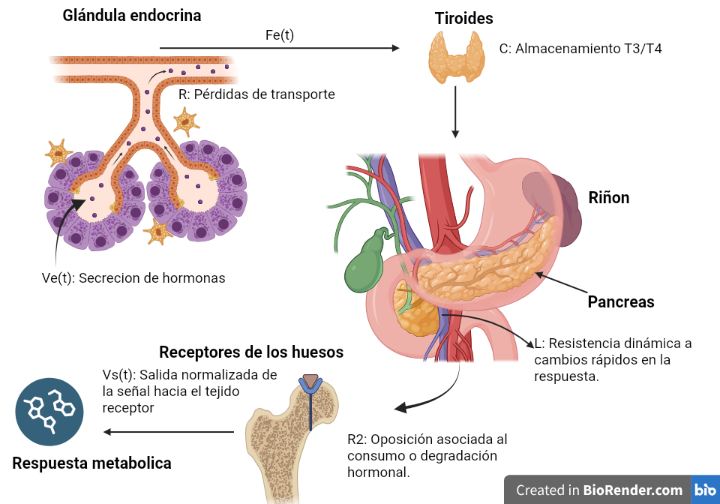
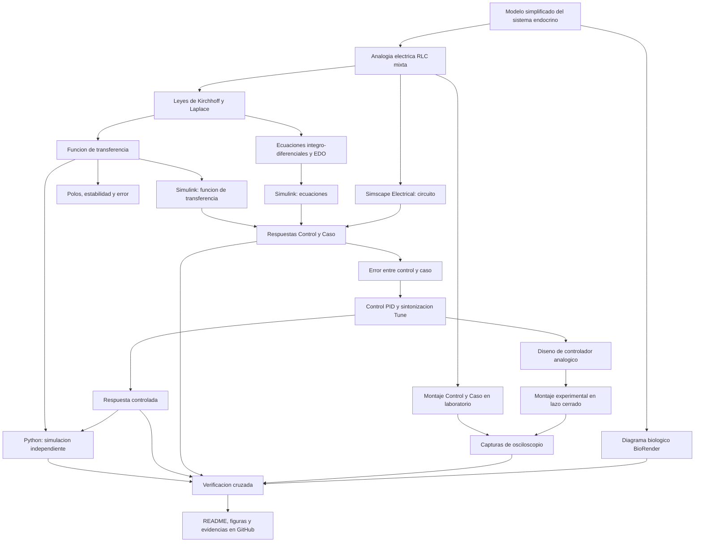

[](https://matlab.mathworks.com/open/github/v1?repo=23212806-debug/MSFP4)

# Práctica 4 — Modelado y control del sistema endocrino

Repositorio académico de la asignatura **Modelado de Sistemas Fisiológicos**, correspondiente al programa de **Ingeniería Biomédica** del Tecnológico Nacional de México / Instituto Tecnológico de Tijuana. Esta práctica integra modelado matemático fenomenológico, analogías eléctricas de sistemas fisiológicos, representación esquemática biológica, análisis temporal y de estabilidad, diseño y sintonización de controladores PID, simulación computacional multiferramienta y comprobación experimental.

El caso de estudio representa la dinámica de **secreción, transporte, almacenamiento y respuesta hormonal del sistema endocrino** mediante un circuito **RLC de segundo orden** con topología mixta. Se compara el comportamiento dinámico de un individuo sano (**Control**) frente a una condición fisiológica alterada (**Caso**), diseñando un controlador PID que utiliza la respuesta del individuo sano como señal de referencia para corregir la respuesta del paciente tanto *in silico* como en el laboratorio.

**Docente:** Dr. Paul Antonio Valle Trujillo  
**Correo:** paul.valle@tectijuana.edu.mx  
**Departamento:** Ingeniería Eléctrica y Electrónica  
**Institución:** Tecnológico Nacional de México / Instituto Tecnológico de Tijuana  
**Asignatura:** Modelado de Sistemas Fisiológicos (`IBF-1020`)  
**Programa:** Ingeniería Biomédica  
**Estudiante:** Pedro Damian Martinez Lozano · `23212806` · `23212806@tectijuana.edu.mx`

**Repositorio de la asignatura:** https://github.com/DrPaulValle/MSF-IBF1020  
**Sede:** Blvd. Alberto Limón Padilla s/n, Tijuana, C.P. 22454, B.C., México.

---

<a id="contenido"></a>
## Contenido

1. [Resumen](#resumen)
2. [Competencia y objetivos](#objetivos)
3. [Relación con el temario](#temario)
4. [Modelo físico y analogía eléctrica](#analogia)
5. [Diagrama biológico del sistema endocrino](#biologico)
6. [Formulación matemática](#modelo)
7. [Análisis temporal y de estabilidad](#analisis)
8. [Señales de entrada y condiciones de simulación](#senales)
9. [Implementación en MATLAB, Simulink y Simscape](#matlab)
10. [Control en lazo cerrado y sintonización PID](#pid)
11. [Reproducción en Python](#python)
12. [Controlador analógico y laboratorio](#laboratorio)
13. [Resultados y verificación cruzada](#resultados)
14. [Flujo de trabajo](#flujo)
15. [Actividades del estudiante](#actividades)
16. [Estructura del repositorio](#estructura)
17. [Requisitos](#requisitos)
18. [Reproducibilidad y entregables](#reproducibilidad)
19. [Referencias](#referencias)

---

<a id="resumen"></a>
## Resumen

Esta práctica tiene como propósito **formular, modelar, simular, controlar y validar experimentalmente** un sistema fisiológico endocrino simplificado mediante analogías eléctricas. A partir de una descripción funcional de los procesos de secreción hormonal, transporte vascular, almacenamiento compartimental y retardo de respuesta en el tejido diana, se propone un circuito eléctrico de segundo orden compuesto por dos resistores ($R_1, R_2$), un capacitor ($C$) y un inductor ($L$).

Mediante las leyes de Kirchhoff y la transformada de Laplace se obtienen las ecuaciones integro-diferenciales y las funciones de transferencia correspondientes a dos condiciones fisiológicas: una condición de referencia saludable (**Control**) y una condición alterada (**Caso**), generada al modificar simultáneamente la capacidad de almacenamiento compartimental ($C$) y la resistencia de utilización o eliminación hormonal ($R_2$). Se evalúan el error en estado estacionario y la estabilidad a través de la ubicación de los polos en el plano complejo.

Posteriormente, se implementa un **controlador PID con retroalimentación negativa** cuyo objetivo es lograr que la salida del paciente ($V_{s,\text{PID}}(t)$) siga la trayectoria dinámica del individuo sano ($V_{s,\text{control}}(t)$) ante una entrada escalón unitario. Las simulaciones se verifican de manera cruzada en **MATLAB/Simulink** (ecuaciones integro-diferenciales y función de transferencia), **Simscape Electrical** (circuito físico) y **Python**, culminando con el montaje físico en protoboard y la medición experimental mediante osciloscopio.

**Palabras clave:** sistema endocrino; circuito RLC; controlador PID; analogía eléctrica; modelado de sistemas fisiológicos; MATLAB; Simulink; Simscape Electrical; Python; instrumentación biomédica.

[Volver al contenido](#contenido)

---

<a id="objetivos"></a>
## Competencia y objetivos

### Competencia a desarrollar

Modelar sistemas fisiológicos mediante analogías eléctricas, ecuaciones diferenciales y funciones de transferencia para analizar su comportamiento dinámico y diseñar estrategias de control clásico, contrastando los resultados entre el análisis matemático, la simulación computacional y la experimentación en el Laboratorio de Electrónica.

### Objetivo general

Proponer, analizar y validar un circuito eléctrico equivalente de segundo orden para representar la dinámica hormonal del sistema endocrino en condiciones normales (**Control**) y alteradas (**Caso**), diseñando un controlador PID que reduzca el error entre ambas respuestas y comprobando los resultados mediante simulación y montaje experimental.

### Objetivos específicos

- Interpretar la descripción funcional del eje endocrino para construir la topología del circuito equivalente, identificando entradas, salidas, flujos y nodos principales.
- Relacionar los elementos del circuito equivalente con las estructuras y procesos fisiológicos del sistema endocrino mediante un diagrama biológico.
- Obtener las ecuaciones integro-diferenciales y las funciones de transferencia $G_{\text{control}}(s)$ y $G_{\text{caso}}(s)$ mediante las leyes de Kirchhoff y la transformada de Laplace.
- Calcular el error en estado estacionario ante una entrada escalón unitario y determinar la estabilidad de ambos sistemas mediante sus polos.
- Implementar y contrastar tres representaciones equivalentes en MATLAB/Simulink: ecuaciones integro-diferenciales, función de transferencia y circuito físico en Simscape Electrical.
- Diseñar y sintonizar un controlador PID en lazo cerrado tomando la respuesta del individuo sano ($V_{s,\text{control}}(t)$) como señal de referencia para el paciente.
- Reproducir de forma independiente las respuestas en lazo abierto y cerrado en Python y verificar su concordancia con MATLAB/Simulink.
- Calcular los valores comerciales de resistores y capacitores para implementar el controlador PID con amplificadores operacionales y validar el sistema en el laboratorio.

[Volver al contenido](#contenido)

---

<a id="temario"></a>
## Relación con el temario

La práctica integra contenidos correspondientes a las tres unidades fundamentales de la asignatura **Modelado de Sistemas Fisiológicos (`IBF-1020`)**:

| Unidad | Área | Contenidos aplicados |
|---|---|---|
| I | Sistemas de control retroalimentados | Diagramas de bloques, seguimiento de trayectoria de referencia, análisis de error en estado estacionario y estabilidad por ubicación de polos |
| II | Modelado matemático | Analogía circuito–sistema endocrino, leyes de Kirchhoff, ecuaciones integro-diferenciales y funciones de transferencia de segundo orden |
| III | Controladores | Diseño de controlador PID, sintonización mediante *PID Tuner* y síntesis analógica con amplificadores operacionales |

[Volver al contenido](#contenido)

---

<a id="analogia"></a>
## Modelo físico y analogía eléctrica

El sistema endocrino se representa de forma fenomenológica mediante un circuito eléctrico de segundo orden. La topología consta de una rama principal de entrada formada por la fuente de voltaje $V_e(t)$ en serie con el resistor $R_1$. En el nodo posterior a $R_1$ —donde se mide el voltaje de salida $V_s(t)$— se conecta un capacitor $C$ hacia la referencia eléctrica, en paralelo con una rama serie formada por el inductor $L$ y el resistor $R_2$ conectados también a referencia.

### Correspondencia de variables y componentes

| Variable / Proceso fisiológico | Representación eléctrica | Interpretación dentro del modelo |
|---|---|---|
| Estímulo para la secreción hormonal | $V_e(t)$ | Voltaje de entrada que activa la secreción glandular (estímulo neural, metabólico u homeostático) |
| Flujo de secreción y transporte hormonal | $F_e(t)$ | Corriente eléctrica que circula por $R_1$ desde la fuente hacia el compartimento de respuesta |
| Pérdidas y oposición durante el transporte | $R_1$ | Resistencia fenomenológica asociada a retrasos o pérdidas en la circulación |
| Acumulación temporal de hormona | $C$ | Capacitancia que modela el almacenamiento transitorio antes de su utilización o eliminación |
| Retardo o inercia de respuesta del tejido diana | $L$ | Inductancia que representa la oposición dinámica a cambios bruscos en la respuesta celular |
| Utilización o eliminación en tejido diana | $R_2$ | Resistencia efectiva asociada al consumo o aclaramiento hormonal en el órgano blanco |
| Flujo de respuesta del tejido diana | $F_s(t)$ | Corriente eléctrica que circula por la rama serie $L$-$R_2$ |
| Nivel hormonal efectivo disponible | $V_s(t)$ | Voltaje de salida medido en el nodo común entre $R_1$, $C$ y $L$ |

### Parámetros comerciales para Control y Caso

La modificación simultánea de la capacitancia $C$ y de la resistencia de utilización $R_2$ permite contrastar la dinámica de un individuo sano (**Control**) frente a una condición fisiológica alterada (**Caso**):

| Componente | Condición Control (Sano) | Condición Caso (Paciente) | Efecto fisiológico modelado |
|---|---:|---:|---|
| $R_1$ | $1\,\mathrm{k}\Omega$ | $1\,\mathrm{k}\Omega$ | Oposición basal al transporte hormonal constante |
| $L$ | $100\,\mathrm{mH}$ | $100\,\mathrm{mH}$ | Inercia basal de respuesta del tejido diana |
| $C$ | $1\,\mu\mathrm{F}$ | $1000\,\mu\mathrm{F}$ | Incremento en el almacenamiento compartimental |
| $R_2$ | $100\,\mathrm{k}\Omega$ | $1\,\mathrm{k}\Omega$ | Aumento en la tasa de eliminación o resistencia a la acción hormonal |

> **Alcance de la analogía:** los valores seleccionados corresponden a componentes comerciales estándar para su emulación en Simscape Electrical y montaje físico en protoboard. Conservan la estructura matemática del fenómeno fisiológico, sin constituir una conversión numérica directa de concentraciones plasmáticas.

[Volver al contenido](#contenido)

---

<a id="biologico"></a>
## Diagrama biológico del sistema endocrino

Para vincular el modelo matemático y la topología eléctrica con la fisiología real, se elaboró un esquema conceptual en **BioRender** que ilustra la correspondencia entre el eje glandular–vascular–órgano diana y los parámetros del circuito equivalente bajo las condiciones **Control** y **Caso**:



* **Estímulo y secreción glandular ($V_e(t)$ y $F_e(t)$):** un estímulo homeostático o neuroendocrino activa la glándula endocrina, generando un flujo secretor inicial hacia el torrente sanguíneo.
* **Transporte vascular ($R_1$):** representa la resistencia hidrodinámica y las pérdidas metabólicas durante el trayecto circulatorio hacia el tejido blanco.
* **Compartimento de distribución y almacenamiento ($C$):** modela la retención temporal de la hormona en el espacio intersticial o plasmático. En la condición **Caso** ($C = 1000\,\mu\mathrm{F}$), el secuestro compartimental aumenta drásticamente, retardando la disponibilidad de la señal.
* **Inercia de señalización y captación en órgano diana ($L$ y $R_2$):** el inductor $L$ refleja el retardo bioquímico en la cascada de segundos mensajeros tras la unión hormona-receptor, mientras que $R_2$ representa la tasa efectiva de utilización o aclaramiento celular (reducida a $1\,\mathrm{k}\Omega$ en el **Caso**, lo que disminuye el nivel hormonal efectivo $V_s(t)$).

[Volver al contenido](#contenido)

---

<a id="modelo"></a>
## Formulación matemática

El desarrollo analítico completo manuscrito se encuentra documentado en [`analisis_matematico.pdf`](analisis_matematico.pdf).

### 1. Ecuaciones integro-diferenciales

Aplicando la ley de corrientes de Kirchhoff (LCK) en el nodo de salida $V_s(t)$ y la ley de voltajes de Kirchhoff (LVK) en las mallas de entrada y de respuesta, se plantean las ecuaciones principales:

$$
F_e(t) = F_C(t) + F_s(t),
$$

donde cada flujo está definido por:

$$
F_e(t) = \frac{V_e(t) - V_s(t)}{R_1}, \qquad F_C(t) = C\frac{dV_s(t)}{dt}, \qquad V_s(t) = L\frac{dF_s(t)}{dt} + R_2 F_s(t).
$$

Despejando las variables de integración y los flujos para la construcción del diagrama de bloques en Simulink (`V(t) Control` y `V(t) Caso`), se obtiene el sistema equivalente:

$$
V_s(t) = V_s(0) + \frac{1}{C}\int_{0}^{t} \left[F_e(\tau) - F_s(\tau)\right] d\tau,
$$

$$
F_s(t) = \frac{1}{R_2}\left[V_s(t) - L\frac{dF_s(t)}{dt}\right], \qquad V_s(t) = L\frac{dF_s(t)}{dt} + R_2 F_s(t).
$$

### 2. Función de transferencia

Considerando condiciones iniciales nulas y aplicando la transformada de Laplace al balance nodal:

$$
\frac{V_e(s) - V_s(s)}{R_1} = Cs V_s(s) + \frac{V_s(s)}{Ls + R_2}.
$$

Agrupando los términos de $V_s(s)$ y resolviendo el cociente salida-entrada se obtiene la función de transferencia general:

$$
\boxed{G(s) = \frac{V_s(s)}{V_e(s)} = \frac{Ls + R_2}{R_1 L C s^2 + (R_1 R_2 C + L)s + (R_1 + R_2)}.}
$$

El denominador es de **segundo grado** debido a los dos elementos independientes de almacenamiento de energía ($C$ y $L$), y presenta un cero finito en $s = -R_2/L$.

Sustituyendo los valores comerciales de cada condición se obtienen las funciones de transferencia específicas:

- **Condición Control (Individuo sano):**

$$
G_{\text{control}}(s) = \frac{0.1s + 100\,000}{0.0001s^2 + 100.1s + 101\,000}
$$

- **Condición Caso (Paciente):**

$$
G_{\text{caso}}(s) = \frac{0.1s + 1\,000}{0.1s^2 + 1000.1s + 2\,000}
$$

### 3. Representación en variables de estado (EDO de primer orden)

Definiendo como variables de estado la energía almacenada en el capacitor $x_1(t) = V_s(t)$ y en el inductor $x_2(t) = F_s(t)$:

$$
\begin{aligned}
\dot{x}_1(t) &= -\frac{1}{R_1 C}x_1(t) - \frac{1}{C}x_2(t) + \frac{1}{R_1 C}V_e(t), \\
\dot{x}_2(t) &= \frac{1}{L}x_1(t) - \frac{R_2}{L}x_2(t), \\
y(t) &= x_1(t).
\end{aligned}
$$

[Volver al contenido](#contenido)

---

<a id="analisis"></a>
## Análisis temporal y de estabilidad

### 1. Error en estado estacionario

Para una entrada escalón unitario $V_e(s) = \frac{1}{s}$, el error en Laplace es $E(s) = [1 - G(s)]V_e(s)$. Aplicando el teorema del valor final:

$$
e_{ss} = \lim_{s \to 0} s E(s) = 1 - G(0) = 1 - \frac{R_2}{R_1 + R_2}.
$$

Evaluando ambas condiciones en lazo abierto:

- **Control:**

$$
V_{s,\text{control}}(\infty) = \frac{100\,000}{1\,000 + 100\,000} \approx 0.9901\,\mathrm{V} \implies e_{ss,\text{control}} = 1 - 0.9901 = 0.0099\;(0.99\%).
$$

- **Caso:**

$$
V_{s,\text{caso}}(\infty) = \frac{1\,000}{1\,000 + 1\,000} = 0.5000\,\mathrm{V} \implies e_{ss,\text{caso}} = 1 - 0.5000 = 0.5000\;(50.0\%).
$$

- **Brecha estacionaria entre Control y Caso:**

$$
e(\infty) = V_{s,\text{control}}(\infty) - V_{s,\text{caso}}(\infty) = 0.990099 - 0.5000 = 0.490099\,\mathrm{V}.
$$

### 2. Polos y estabilidad

Las raíces de la ecuación característica $R_1 L C s^2 + (L + R_1 R_2 C)s + (R_1 + R_2) = 0$ determinan la estabilidad y velocidad de respuesta:

| Condición | Ecuación característica | Polos ($s_{1,2}$) | Clasificación dinámica |
|---|---|---|---|
| **Control** | $0.0001s^2 + 100.1s + 101\,000 = 0$ | $s_1 = -1010.0101$, $s_2 = -999\,989.9899$ | Estable, sobreamortiguado (respuesta ultrarrápida) |
| **Caso** | $0.1s^2 + 1000.1s + 2\,000 = 0$ | $s_1 = -2.0002$, $s_2 = -9998.9998$ | Estable, sobreamortiguado (polo dominante lento $\tau \approx 0.5\,\mathrm{s}$) |

Ambos sistemas son **asintóticamente estables** al tener todos sus polos reales y negativos en el semiplano izquierdo. El incremento de $1000\times$ en $C$ desplaza el polo dominante desde $s_1 = -1010.01$ hasta $s_1 = -2.0002$, volviendo la respuesta transitoria del paciente aproximadamente $500$ veces más lenta.

### 3. Bosquejo cualitativo previo

De acuerdo con la localización de los polos y el valor final calculado en [`analisis_matematico.pdf`](analisis_matematico.pdf):

- **Control:** crecimiento exponencial monótono sin sobreimpulso desde $0\,\mathrm{V}$ hasta estabilizarse prácticamente en $1\,\mathrm{V}$ ($0.9901\,\mathrm{V}$) en pocos milisegundos.
- **Caso:** crecimiento exponencial monótono mucho más lento desde $0\,\mathrm{V}$ hasta estabilizarse en $0.5\,\mathrm{V}$ alrededor de $t \approx 2\,\mathrm{s}$ ($4\tau \approx 2\,\mathrm{s}$).

[Volver al contenido](#contenido)

---

<a id="senales"></a>
## Señales de entrada y condiciones de simulación

La simulación numérica se ejecuta en el intervalo $0 \le t \le 10\,\mathrm{s}$ bajo condiciones iniciales nulas ($x_0 = 0$).

| Parámetro | MATLAB / Simulink (`sistema1.slx`) | Python (`Martinez23212806.py`) |
|---|---|---|
| Señal de entrada $V_e(t)$ | Escalón unitario $u(t)$ en $t = 0\,\mathrm{s}$ | Vector escalón unitario `u = np.ones(N)` |
| Intervalo temporal | $t \in [0, 10]\,\mathrm{s}$ | $t \in [0, 10]\,\mathrm{s}$ ($N = 10\,001$ muestras) |
| Solver / Paso de integración | Solver rígido `ode15s`, paso máximo $\Delta t = 10^{-2}\,\mathrm{s}$ | Paso uniforme $\Delta t = 10^{-3}\,\mathrm{s}$ (`ctrl.forced_response`) |

El uso del solver rígido **`ode15s`** en Simulink es fundamental debido a la amplia separación entre las constantes de tiempo rápidas y lentas de los polos del sistema ($\lambda_2 \approx -10^6$ frente a $\lambda_1 \approx -2$).

[Volver al contenido](#contenido)

---

<a id="matlab"></a>
## Implementación en MATLAB, Simulink y Simscape

El archivo [`sistema1.slx`](sistema1.slx) contiene los subsistemas **Control** y **Caso**, contrastando tres metodologías equivalentes de modelado:

| Implementación | Bloques en `sistema1.slx` | Señal de salida | Aspecto verificado |
|---|---|---|---|
| Ecuaciones integro-diferenciales | Subsistemas `V(t) Control` y `V(t) Caso` (integradores, derivadores, sumadores y ganancias $1/C$, $1/R_1$, $1/R_2$, $L$) | `Vs(t): Control EID` / `VsPID` | Equivalencia directa con las leyes de Kirchhoff |
| Función de transferencia | Bloques `F(t): Control` y `F(t): Caso` (`TransferFcn`) | `Vsx` / `Vsy` | Dinámica entrada–salida de segundo orden |
| Circuito equivalente físico | Bloques de **Simscape Electrical** (`Resistor`, `Capacitor`, `Inductor`, `Controlled Voltage Source`, `Voltage Sensor`) | `Vs(t): Control CE` / `Ve` | Concordancia física con los modelos matemáticos |

### Ejecución desde el cuaderno MATLAB

El cuaderno computacional [`Martinez23212806.mlx`](Martinez23212806.mlx) (exportado en [`cuadernillo_MATLAB.pdf`](cuadernillo_MATLAB.pdf)) ejecuta automáticamente `sistema1.slx`, recupera del *Workspace* las variables `ve`, `Vsx`, `Vsy` y `vsPID` registradas mediante bloques `To Workspace`, y genera la figura comparativa [`grafica_MATLAB.pdf`](grafica_MATLAB.pdf).

[Volver al contenido](#contenido)

---

<a id="pid"></a>
## Control en lazo cerrado y sintonización PID

### 1. Esquema de control con referencia fisiológica

A diferencia de un regulador de punto fijo constante, el controlador PID utiliza la respuesta dinámica del individuo sano $V_{s,\text{control}}(t)$ como trayectoria de referencia para corregir la respuesta del paciente:

$$
e(t) = V_{s,\text{control}}(t) - V_{s,\text{PID}}(t).
$$

La ley de control en el dominio de Laplace está dada por:

$$
K(s) = k_P + \frac{k_I}{s} + k_D s.
$$

### 2. Ganancias sintonizadas

Mediante la herramienta **PID Tuner** de Simulink (evidencia resguardada en [`controlador_PID.png`](controlador_PID.png)) y su validación en Python, se obtuvieron los siguientes conjuntos de parámetros que logran el seguimiento de trayectoria con sobreimpulso mínimo y error estacionario nulo:

| Entorno de simulación | $k_P$ | $k_I$ | $k_D$ | Observaciones de implementación |
|---|---:|---:|---:|---|
| **Simulink (`sistema1.slx`)** | $1292.1889$ | $309\,191.9526$ | $0.17968$ | PID paralelo continuo con filtro derivativo $N = 4938.6985$ |
| **Python (`Martinez23212806.py`)** | $13\,209.9564$ | $32\,316\,525.9285$ | $0.18118$ | Implementación ideal de función de transferencia $K(s)$ |

### 3. Síntesis del controlador analógico

Para la implementación física del controlador mediante amplificadores operacionales, se fija un capacitor de referencia $C_r = 1\,\mu\mathrm{F}$ y se determinan los componentes pasivos mediante las relaciones de diseño:

$$
R_e = \frac{1}{C_r k_I}, \qquad R_r = k_P R_e, \qquad C_e = \frac{k_D}{R_r}.
$$

> **Nota sobre la topología analógica:** la función de transferencia de una red PID con amplificadores operacionales responde a $K(s) = \frac{(R_e C_e s + 1)(R_r C_r s + 1)}{R_e C_r s}$, cuyo término proporcional efectivo incluye la contribución $\frac{R_r}{R_e} + \frac{C_e}{C_r}$. Al seleccionar valores comerciales estándar, debe verificarse su respuesta en Simscape Electrical antes del montaje físico.

[Volver al contenido](#contenido)

---

<a id="python"></a>
## Reproducción en Python

El script [`Martinez23212806.py`](Martinez23212806.py), desarrollado en **Visual Studio Code** con las bibliotecas `numpy`, `control` y `matplotlib`, reproduce de forma independiente el modelado y control del sistema:

1. **Definición del vector temporal:** $t \in [0, 10]\,\mathrm{s}$ con paso $\Delta t = 10^{-3}\,\mathrm{s}$ y entrada escalón unitario.
2. **Construcción de plantas:** función `sis(C, R2, nombre)` que define `sysControl` y `sysCaso` mediante `ctrl.tf(num, den)`.
3. **Síntesis del controlador PID:** cálculo de $R_e, R_r, C_e$ a partir de $k_P, k_I, k_D$ y definición de `PID = ctrl.tf(numPID, denPID)`.
4. **Lazo cerrado:** interconexión en serie `ctrl.series(PID, sysCaso)` con retroalimentación negativa unitaria `ctrl.feedback(..., 1, sign=-1)`.
5. **Simulación forzada:** evaluación mediante `ctrl.forced_response`, aplicando la salida `Control` como señal de referencia para el sistema `sysPID`.
6. **Exportación gráfica:** generación de la comparativa en [`grafica_PYTHON.png`](grafica_PYTHON.png).

[Volver al contenido](#contenido)

---

<a id="laboratorio"></a>
## Controlador analógico y laboratorio

### Materiales y equipo

- **Planta pasiva (Control y Caso):** resistores de $1\,\mathrm{k}\Omega$ y $100\,\mathrm{k}\Omega$, inductor de $100\,\mathrm{mH}$, capacitores de $1\,\mu\mathrm{F}$ y $1000\,\mu\mathrm{F}$, protoboard y cables de conexión.
- **Controlador analógico:** amplificadores operacionales alimentados con fuente simétrica $V_{CC} = +15\,\mathrm{V}$ y $V_{EE} = -15\,\mathrm{V}$, junto con resistores y capacitores de valores comerciales.
- **Instrumentación:** generador de funciones (configurado con onda cuadrada/pulso de baja frecuencia y offset DC para aproximar el escalón unitario de $0\,\mathrm{V}$ a $1\,\mathrm{V}$), fuente de alimentación DC simétrica, multímetro digital y osciloscopio.

### Procedimiento experimental

1. **Lazo abierto:** montaje en protoboard de las topologías **Control** y **Caso**, aplicando la aproximación experimental al escalón unitario y midiendo simultáneamente $V_e(t)$ y $V_s(t)$.
2. **Lazo cerrado:** acoplamiento del controlador PID analógico con la planta **Caso**, suministrando como referencia la señal de control y registrando la respuesta corregida $V_{s,\text{PID}}(t)$ en [`grafica_LABORATORIO.jpeg`](grafica_LABORATORIO.jpeg).

[Volver al contenido](#contenido)

---

<a id="resultados"></a>
## Resultados y verificación cruzada

### Evidencias gráficas del repositorio

| Herramienta / Etapa | Archivo generado | Descripción de la evidencia |
|---|---|---|
| **MATLAB / Simulink** | [`grafica_MATLAB.pdf`](grafica_MATLAB.pdf) | Comparación de $V_e(t)$, $V_{s,\text{control}}(t)$, $V_{s,\text{caso}}(t)$ y $V_{s,\text{PID}}(t)$ desde `Martinez23212806.mlx` |
| **Python** | [`grafica_PYTHON.png`](grafica_PYTHON.png) | Simulación independiente de las respuestas en lazo abierto y lazo cerrado con PID |
| **Sintonización PID** | [`controlador_PID.png`](controlador_PID.png) | Captura de sintonización del bloque `PID Controller` en Simulink |
| **Laboratorio** | [`grafica_LABORATORIO.jpeg`](grafica_LABORATORIO.jpeg) | Captura experimental obtenida en el osciloscopio del montaje físico |

### Discusión de resultados

- **Concordancia *in silico*:** las tres implementaciones en `sistema1.slx` (ecuaciones integro-diferenciales, función de transferencia y circuito Simscape Electrical) y el script en Python (`Martinez23212806.py`) producen curvas superpuestas, validando la exactitud del modelo matemático.
- **Comparación Control vs. Caso:** en lazo abierto, la condición **Control** alcanza $0.9901\,\mathrm{V}$ de forma casi instantánea, mientras que la condición **Caso** presenta un retardo pronunciado y se estanca en $0.5000\,\mathrm{V}$ ($50\%$ de error estacionario).
- **Desempeño del controlador PID:** al cerrar el lazo utilizando $V_{s,\text{control}}(t)$ como referencia, la salida controlada $V_{s,\text{PID}}(t)$ elimina el error en estado estacionario y reproduce la dinámica rápida del individuo sano.
- **Discrepancias experimentales:** las ligeras variaciones observadas en la captura del osciloscopio respecto a las curvas ideales se atribuyen a la resistencia serie equivalente (ESR) del inductor real de $100\,\mathrm{mH}$, las tolerancias de los capacitores electrolíticos ($1000\,\mu\mathrm{F}$) y resistores ($\pm 5\%$), la aproximación a valores comerciales en el controlador analógico y las características no ideales de los amplificadores operacionales.

[Volver al contenido](#contenido)

---

<a id="flujo"></a>
## Flujo de trabajo



[Volver al contenido](#contenido)

---

<a id="actividades"></a>
## Actividades del estudiante

- [x] Proponer el circuito eléctrico equivalente identificando $V_e(t)$, $V_s(t)$, $F_e(t)$, $F_s(t)$, $R_1$, $C$, $L$ y $R_2$.
- [x] Elaborar el diagrama biológico relacionando los procesos endocrinos con el circuito equivalente ([`biorender.png`](biorender.png)).
- [x] Derivar las ecuaciones integro-diferenciales, funciones de transferencia y representación en EDO ([`analisis_matematico.pdf`](analisis_matematico.pdf)).
- [x] Calcular los polos, analizar la estabilidad, determinar el error en estado estacionario y trazar el bosquejo cualitativo.
- [x] Implementar y contrastar ecuaciones integro-diferenciales, función de transferencia y circuito en Simscape Electrical ([`sistema1.slx`](sistema1.slx)).
- [x] Diseñar el sistema en lazo cerrado utilizando la respuesta **Control** como referencia y sintonizar el PID ([`controlador_PID.png`](controlador_PID.png)).
- [x] Desarrollar el cuaderno computacional en MATLAB ([`Martinez23212806.mlx`](Martinez23212806.mlx)) y exportar [`cuadernillo_MATLAB.pdf`](cuadernillo_MATLAB.pdf) y [`grafica_MATLAB.pdf`](grafica_MATLAB.pdf).
- [x] Reproducir las simulaciones en Python ([`Martinez23212806.py`](Martinez23212806.py)) y generar [`grafica_PYTHON.png`](grafica_PYTHON.png).
- [x] Construir el circuito y controlador analógico en laboratorio y registrar [`grafica_LABORATORIO.jpeg`](grafica_LABORATORIO.jpeg).
- [x] Integrar documentación técnica en `README.md` y archivo de citación `CITATION.cff`.

[Volver al contenido](#contenido)

---

<a id="estructura"></a>
## Estructura del repositorio

```text
.
├── README.md                      # Reporte técnico y guía de reproducción de la práctica
├── CITATION.cff                   # Metadatos de citación del repositorio
├── Martinez23212806.mlx           # Cuaderno computacional en MATLAB
├── cuadernillo_MATLAB.pdf         # Exportación en PDF del cuaderno MATLAB
├── sistema1.slx                   # Modelo en Simulink y Simscape Electrical
├── Martinez23212806.py            # Script de simulación y control en Python
├── analisis_matematico.pdf        # Desarrollo analítico, polos, error y bosquejos
├── biorender.png                  # Esquema biológico del sistema endocrino
├── controlador_PID.png            # Evidencia de sintonización del bloque PID Controller
├── grafica_MATLAB.pdf             # Gráfica comparativa generada desde MATLAB
├── grafica_PYTHON.png             # Gráfica comparativa generada desde Python
└── grafica_LABORATORIO.jpeg       # Captura experimental del osciloscopio
```

[Volver al contenido](#contenido)

---

<a id="requisitos"></a>
## Requisitos

### Software

- **MATLAB** y **Simulink** (con **Control System Toolbox** y **Simscape Electrical**).
- **Python 3.x** ejecutado en **Visual Studio Code**, con las siguientes dependencias:

```bash
pip install numpy matplotlib scipy control
```

- **Git y GitHub** para control de versiones y publicación del repositorio.

### Hardware e instrumentación de laboratorio

- Resistores ($1\,\mathrm{k}\Omega$, $100\,\mathrm{k}\Omega$ y valores comerciales del PID), inductor ($100\,\mathrm{mH}$), capacitores ($1\,\mu\mathrm{F}$, $1000\,\mu\mathrm{F}$ y $C_e, C_r$), amplificadores operacionales, protoboard y cables.
- Fuente de alimentación DC simétrica ($\pm 15\,\mathrm{V}$), generador de funciones, multímetro digital y osciloscopio.

[Volver al contenido](#contenido)

---

<a id="reproducibilidad"></a>
## Reproducibilidad y entregables

### Secuencia de reproducción

1. Consultar el [repositorio general de la asignatura](https://github.com/DrPaulValle/MSF-IBF1020) y el instructivo de la práctica.
2. Identificar los procesos hormonales, flujos $F_e(t), F_s(t)$, señales $V_e(t), V_s(t)$ y componentes $R_1, C, L, R_2$.
3. Construir la analogía eléctrica RLC mixta y desarrollar las ecuaciones integro-diferenciales mediante leyes de Kirchhoff.
4. Obtener $G(s) = V_s(s)/V_e(s)$ y comprobar el nodo de medición de salida utilizado en Simulink.
5. Utilizar los parámetros comerciales de referencia: $C = 1\,\mu\mathrm{F}, R_2 = 100\,\mathrm{k}\Omega$ (**Control**) y $C = 1000\,\mu\mathrm{F}, R_2 = 1\,\mathrm{k}\Omega$ (**Caso**), con $R_1 = 1\,\mathrm{k}\Omega$ y $L = 100\,\mathrm{mH}$.
6. Ejecutar las representaciones por ecuaciones, función de transferencia y Simscape Electrical en [`sistema1.slx`](sistema1.slx).
7. Calcular polos, estabilidad y error en estado estacionario para cada condición ([`analisis_matematico.pdf`](analisis_matematico.pdf)).
8. Ejecutar la simulación al escalón unitario en un intervalo de $10\,\mathrm{s}$ con el solver `ode15s` y contrastar las respuestas de Control y Caso.
9. Sintonizar el PID mediante **Tune** utilizando la respuesta Control como referencia y conservar ganancias y evidencia ([`controlador_PID.png`](controlador_PID.png)).
10. Ejecutar el cuaderno de MATLAB ([`Martinez23212806.mlx`](Martinez23212806.mlx)) y generar las figuras de las señales ([`grafica_MATLAB.pdf`](grafica_MATLAB.pdf)).
11. Reproducir las respuestas en Python ([`Martinez23212806.py`](Martinez23212806.py)) bajo las mismas condiciones ([`grafica_PYTHON.png`](grafica_PYTHON.png)).
12. Elaborar el diagrama biológico ([`biorender.png`](biorender.png)), implementar los circuitos en protoboard ([`grafica_LABORATORIO.jpeg`](grafica_LABORATORIO.jpeg)) y realizar la verificación cruzada.
13. Publicar el repositorio con `README.md`, las evidencias y `CITATION.cff`.

### Resultados mínimos esperados

| Entregable | Evidencia solicitada |
|---|---|
| Identificación del modelo | Estímulo, nivel hormonal, flujos, almacenamiento, inercia y utilización |
| Analogía eléctrica | Esquema y correspondencia entre variables endocrinas y circuito RLC mixto |
| Formulación matemática | Ecuaciones integro-diferenciales, variables de estado y función de transferencia |
| Análisis del sistema | Polos, estabilidad, error estacionario y bosquejos de Control y Caso |
| Simulink y Simscape | Representaciones equivalentes y respuestas al escalón en [`sistema1.slx`](sistema1.slx) |
| PID | Ganancias obtenidas con **Tune** y comparación en lazo cerrado |
| MATLAB | Cuaderno `.mlx` ([`Martinez23212806.mlx`](Martinez23212806.mlx)), exportación `.pdf` y gráfica |
| Python | Código `.py` ([`Martinez23212806.py`](Martinez23212806.py)) y figura comparativa |
| Laboratorio | Síntesis analógica, montaje físico y captura del osciloscopio |
| Diagrama biológico | Relación del modelo fisiológico y eléctrico con estructuras endocrinas reales |
| Documentación | `README.md`, `CITATION.cff`, conclusiones y evidencias |

### Criterios de presentación académica

El README final distingue entre **expresiones del instructivo**, **elementos identificados en los archivos aportados**, **predicciones analíticas** y **resultados obtenidos efectivamente de la simulación y experimentación**. Las figuras, ganancias y conclusiones corresponden a ejecuciones verificadas del modelo. Cualquier ajuste en las ganancias del controlador entre el entorno de Simulink (con filtro derivativo $N$) y Python (función de transferencia ideal) queda explícitamente documentado.

[Volver al contenido](#contenido)

---

<a id="referencias"></a>
## Referencias

[1] M. C. Khoo, *Physiological Control Systems: Analysis, Simulation, and Estimation*, 2nd ed., IEEE Press, 2018.

[2] F. C. Hoppensteadt y C. S. Peskin, *Modeling and Simulation in Medicine and the Life Sciences*, Springer.

[3] J. E. Hall, *Guyton and Hall Textbook of Medical Physiology*, 14th ed., Elsevier, 2021.

[4] K. Ogata, *Ingeniería de Control Moderna*, 5.ª ed., Pearson Educación, 2010.

[5] N. S. Nise, *Control Systems Engineering*, 8th ed., John Wiley & Sons, 2020.

[6] P. A. Valle, *Syllabus para Modelado de Sistemas Fisiológicos*, Tecnológico Nacional de México / Instituto Tecnológico de Tijuana, Tijuana, B.C., México, 2026. Disponible en: https://biomath.xyz/course/

[7] Tecnológico Nacional de México, *Programa de estudio de la asignatura Modelado de Sistemas Fisiológicos, IBF-1020*.

---

## Uso académico

Este repositorio constituye evidencia académica de la **Práctica 4: Modelado y control del sistema endocrino** de la asignatura **Modelado de Sistemas Fisiológicos (`IBF-1020`)** en el Tecnológico Nacional de México / Instituto Tecnológico de Tijuana.
